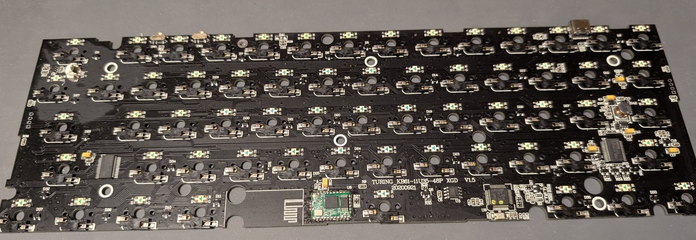
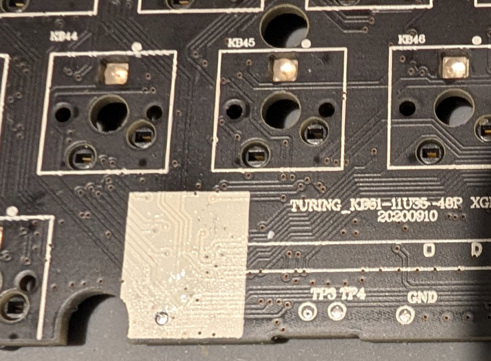
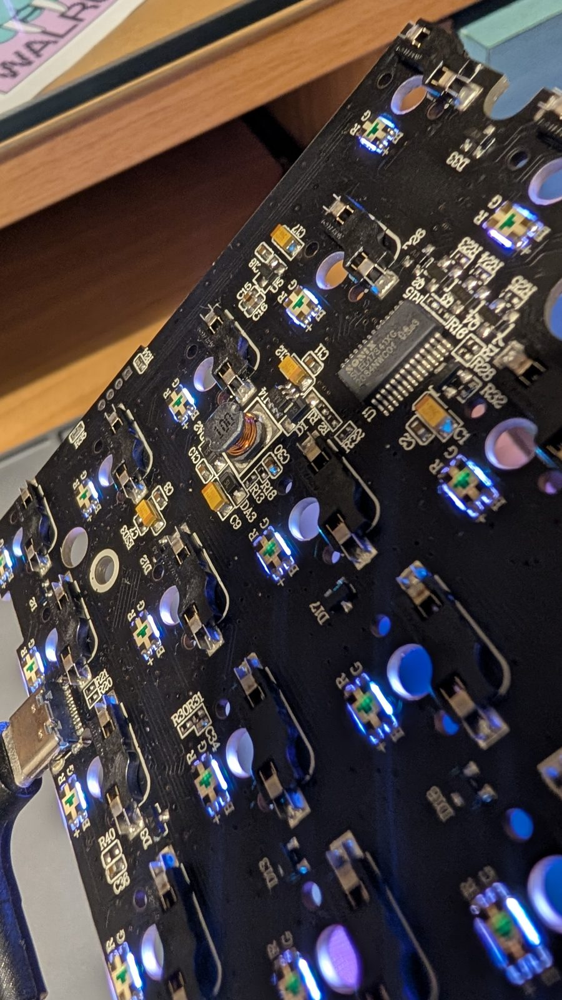

# kemove-dk61-qmk

QMK for the old-generation Kemove DK61 Shadow / Snowfox (PCB v1.5): the stock layout and Fn shortcuts, Bluetooth, RGB lighting, profiles, battery level and sleep, all configurable in VIA.



> **Use at your own risk.** Flashing means opening the keyboard once and replacing Kemove's bootloader. Take the full backup described below first. This is a work in progress.

## Is this your board?

"DK61" covers several unrelated designs. This repo is for the first one.

| Generation | USB ID (wired) | MCU | Covered here |
| --- | --- | --- | --- |
| Old ("Turing Gaming Keyboard") | `1EA7:9006` Shadow, `1EA7:9005` Snowfox | NXP LPC11U35 | Yes, PCB v1.5 |
| Two Mode | `0C45:8075` | Sonix SN32F24xB | Notes only |
| Three Mode (2.4G) | `0C45:8006` | Sonix SN32F24xB | Notes only |

The PCB revision is printed on the board. v1.4 shares the v1.5 pin layout but is untested here; v1.2 and v3.0 need different builds.

## Status

| | |
| --- | --- |
| USB typing, NKRO, stock layout and Fn layer | Tested |
| Updates over USB, no disassembly | Tested |
| Saved settings, VIA keymap editing | Tested |
| Bluetooth: pairing, typing, media keys, reconnect at power up and after a drop | Tested |
| RGB lighting and effects, profiles, Fn and Win lock, factory reset | Tested |
| Battery level, lights off on battery after idle | Tested |
| Automatic Windows/Mac layout | Tested on macOS |
| VIA Kemove page | Built, not yet tried in the VIA app |

Every key, indicator and setting is described in the [keyboard readme](qmk/keyboards/kemove/snowfox/readme.md). Kemove's APEX software does not talk to QMK; VIA replaces it.

## What is in here

- `qmk/keyboards/kemove/snowfox/`: the keyboard, for current QMK. The `default` keymap is the stock layout and Fn shortcuts from Kemove's K61 manual, `via` is the same with VIA and its Kemove settings page.
- `qmk/via/`: VIA definition, with the lighting menu and the Kemove page. Load it in VIA's Design tab until VIA lists the keyboard.
- `qmk/patches/`: LPC11U35 support for QMK, USB driver fixes for ChibiOS-Contrib, and a bootloader build fix.
- `tools/sfdfu.py`: firmware updater for the OpenKemove bootloader. `dfu-util` fails with it on macOS.
- `tools/analysis/`: scripts used to unpack Kemove's installers and inspect firmware images.
- `docs/hardware-notes.md`: what was verified about the hardware, and how.

No Kemove firmware is included.

## Build

Needs `arm-none-eabi-gcc` and the QMK CLI.

```sh
# QMK
git clone --recursive -b develop https://github.com/qmk/qmk_firmware.git
cd qmk_firmware
git am ../qmk/patches/qmk-lpc11u35-support.patch
git -C lib/chibios-contrib apply ../../../qmk/patches/chibios-contrib-lpc11uxx-usb-fixes.patch
cp -r ../qmk/keyboards/kemove keyboards/
make kemove/snowfox/v1_5:default   # or :via

# Bootloader
git clone --recursive https://github.com/OpenKemove/kemove_lpc_dfu.git
cd kemove_lpc_dfu
git apply ../qmk/patches/kemove_lpc_dfu-static-inline.patch
make V1_5 USE_OPT="-Os -g -fomit-frame-pointer -falign-functions=16"
```

The QMK patch and the USB fixes are open upstream as [qmk_firmware#26517](https://github.com/qmk/qmk_firmware/pull/26517) and [ChibiOS-Contrib#456](https://github.com/ChibiOS/ChibiOS-Contrib/pull/456).

The bootloader must be 8192 bytes or smaller. Built at the default `-O2` with a current GCC it is not.

## First install

1. Remove the keycaps, switches and PCB screws, lift the PCB and unplug the battery.
2. Short test pad `TP3` to `GND` while plugging in USB. A 64 KB drive named `CRP DISABLD` appears, holding `firmware.bin`.
3. **Back up:** `cat "/Volumes/CRP DISABLD/firmware.bin" > stock_backup.bin`. Keep it; it is the only way back to stock.
4. Build one 64 KB image: the bootloader at `0x0000`, the QMK image at `0x2000`, `0xFF` everywhere else.
5. Write it in place and unmount:

   ```sh
   dd if=image_64k.bin of="/Volumes/CRP DISABLD/firmware.bin" conv=notrunc bs=512
   sync && diskutil unmount "/Volumes/CRP DISABLD"
   ```

6. Repeat step 2 and compare `firmware.bin` with your image, then replug normally.

`TP3`, `TP4` and `GND` are on the switch side, below the space bar row:



On macOS use Terminal only; do not open the drive in Finder.

Never write an image whose 32-bit word at `0x2FC` is `0x12345678`, `0x87654321`, `0x43218765` or `0x4E697370`. Those turn on the chip's code read protection, and the last two disable this recovery mode for good.

## Lighting hiss

With the lights on, some boards hiss or whine. It is the open 10 µH coil marked `100` next to the right LED driver chip, at the bottom left seen from the keys: the LED drivers pull current in pulses, and its exposed winding vibrates. Kemove's firmware does the same.

- Firmware: brightness is set with the LED drive current, so every step below full is quieter. The default brightness is the quiet level. Full brightness hisses as on stock.
- Hardware: with the battery unplugged, soak the coil's winding in clear nail varnish (top coat, not glitter or metallic) or cover it with hot glue, and let it set. Pressing on the coil with a finger stops the noise, which is a quick way to check it is yours.



## Update

1. Press Fn+B, use Enter update mode in VIA, or hold Esc while plugging in. The keyboard goes dark and shows up as `feed:6969`.
2. `pip install pyusb`, then `tools/sfdfu.py firmware.bin`. It writes, reads back, verifies and restarts the keyboard.

## Back to stock

Repeat step 2 of the install and write your backup with the same `dd` command.

## Credits

- [OpenKemove](https://openkemove.github.io/): the LPC11Uxx QMK port and DFU bootloader.
- [hftsai256](https://github.com/hftsai256/openkemove_qmk_firmware): v1.4/v1.5 support and three Bluetooth devices.
- [thedelog](https://github.com/thedelog/Kemove-Snowfox-Media_keys_on_BLE): media keys over Bluetooth, and the tree this was ported from.
- The OpenKemove Discord, for the `TP3` tip.

## License

GPL-2.0-or-later, as QMK.
